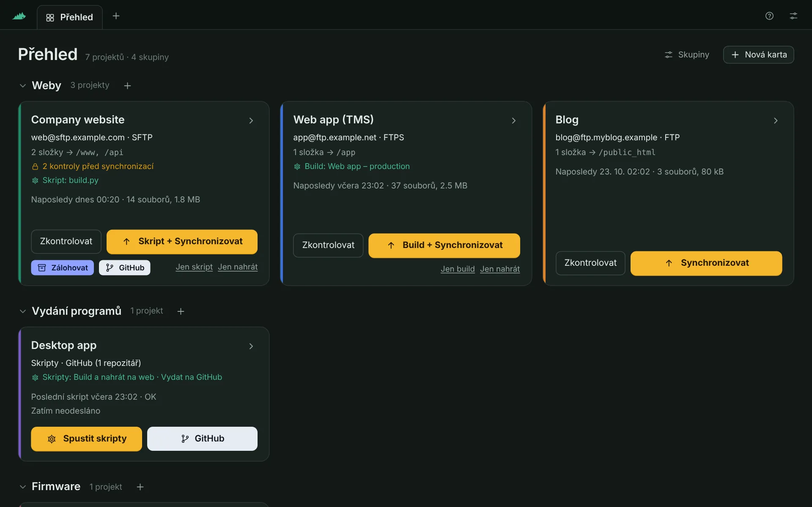
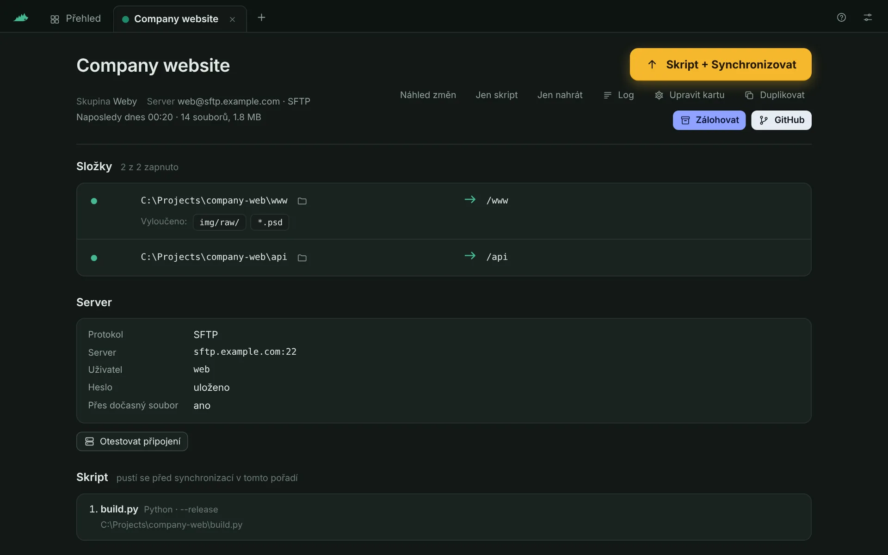
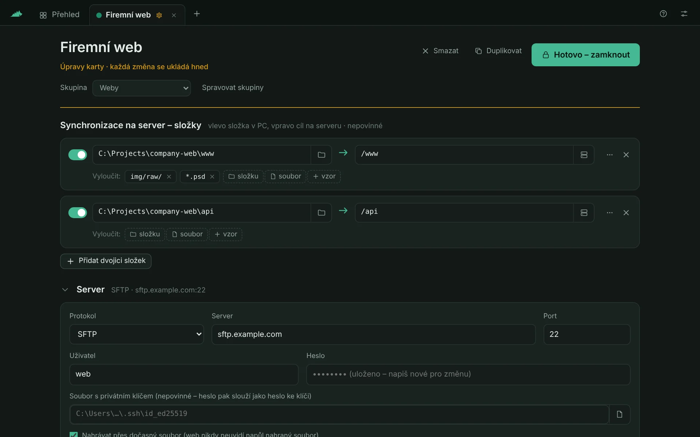
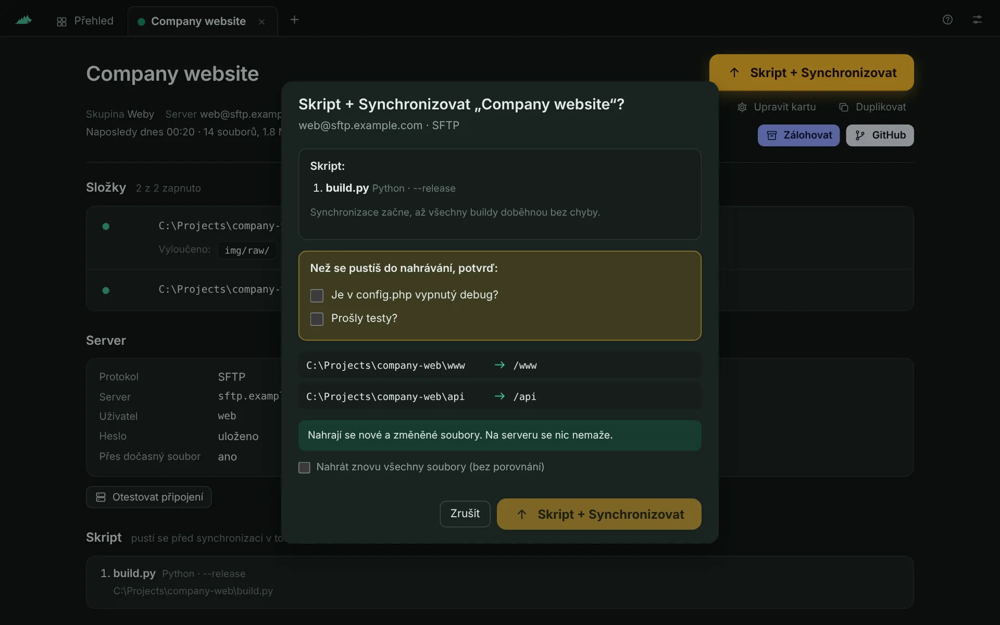
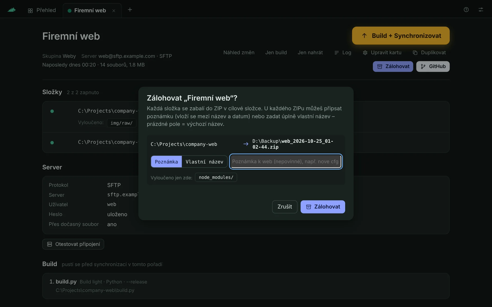
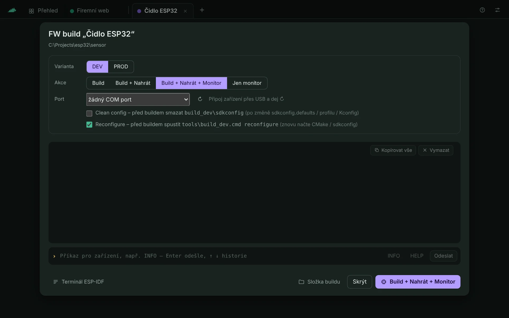
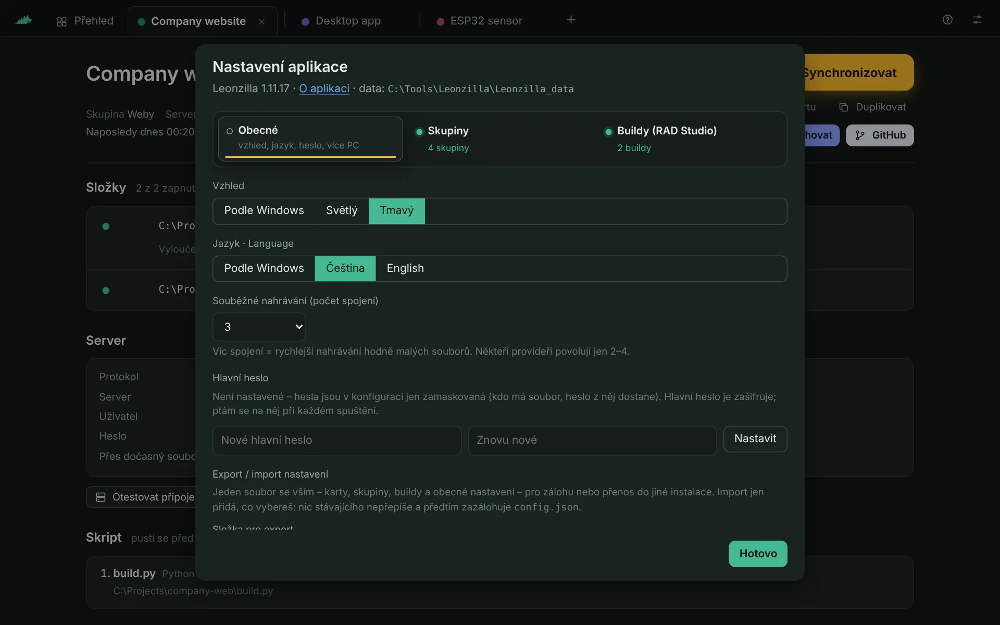
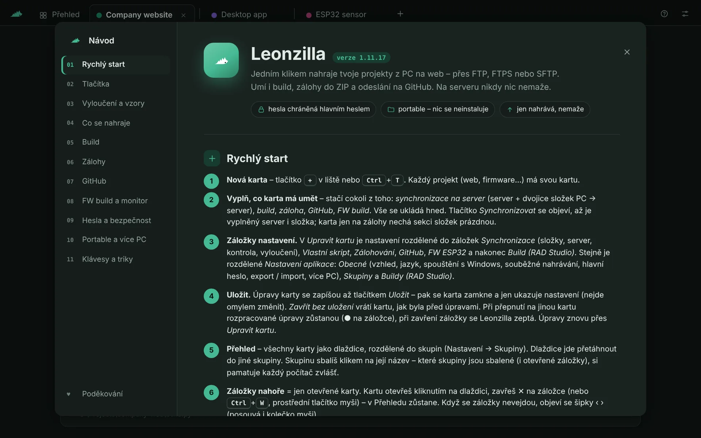
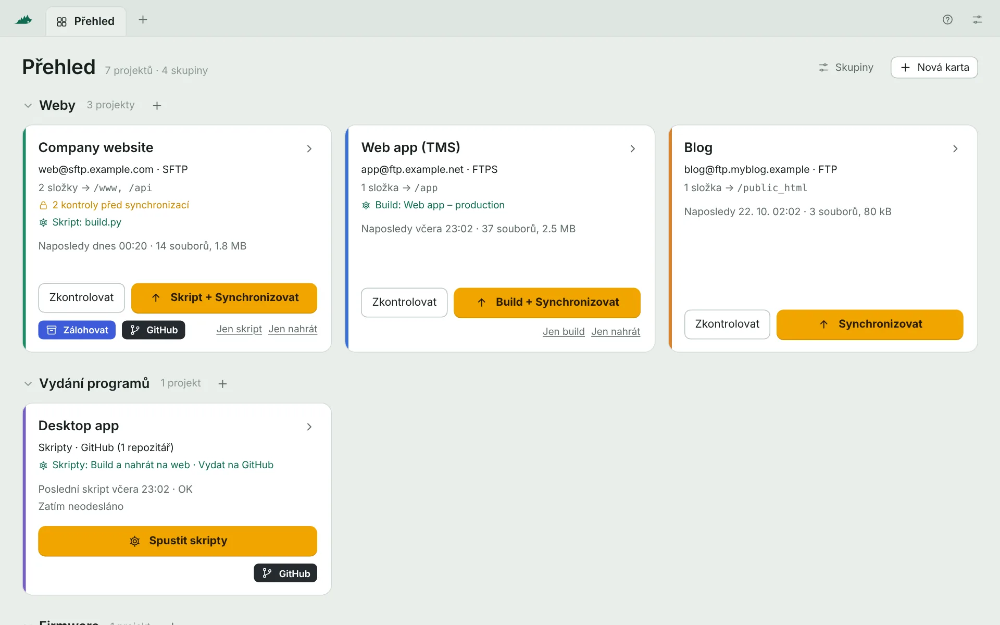
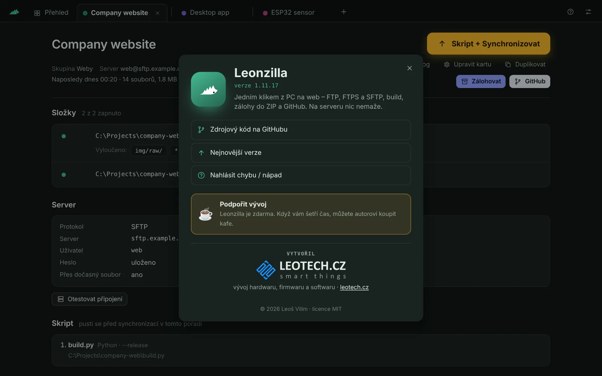

<p align="center">
  
</p>

<h1 align="center">Leonzilla</h1>

<p align="center">
  <b>Jedním klikem z PC na web.</b><br>
  Nahrávání složek přes FTP / FTPS / SFTP, build předem, zálohy do ZIP, push na GitHub –<br>
  malá přenosná aplikace pro Windows, která na serveru nikdy nic nemaže.
</p>

<p align="center">
  <a href="https://github.com/Leontech/leonzilla/releases/latest/download/Leonzilla.zip"><b>⬇ Stáhnout Leonzillu pro Windows</b></a>
  &nbsp;·&nbsp; <a href="https://github.com/Leontech/leonzilla/releases">Všechny verze</a>
  &nbsp;·&nbsp; <a href="README.md">English</a>
  &nbsp;·&nbsp; <a href="https://ko-fi.com/leotechcz">☕ Kafe pro autora</a>
</p>



## Bezpečná a přenosná

- 🔒 **Hlavní heslo** – hesla k serverům se šifrují klíčem odvozeným z hlavního hesla (scrypt + AES-256-GCM). Leonzilla se na něj ptá **při každém spuštění**; bez něj hesla z konfigurace nikdo nepřečte – ani samotnou Leonzillou.
- 🧳 **Portable** – žádná instalace, žádná služba, nic se nezapisuje do registru (pokud nezapneš spouštění s Windows): jen `Leonzilla.exe` a vedle něj složka `Leonzilla_data`. Dá se nosit na flashce nebo mít v Dropboxu a používat na více PC (velikost okna apod. se ukládá na každém PC zvlášť mimo Dropbox).
- 🛡 **Na serveru nic nemaže** – jen nahrává nové a změněné soubory, přes dočasný soubor, který se po dokončení přejmenuje, a kontroluje velikost.
- 🔑 **Klíč SFTP serveru se pamatuje** – když se změní, Leonzilla se nepřipojí, dokud to nepotvrdíš.
- 🏠 **Jen lokálně** – okno mluví s Leonzillou na `127.0.0.1` s náhodným portem a tokenem. Žádná telemetrie ani cloud – data jdou jen na tvoje servery a do tvých Git repozitářů.

## Jak to vzniklo

Leonzilla začala jako nástroj na jednu otravnou práci: **zbuildovat webovou aplikaci v TMS WEB Core** (RAD Studio / Delphi) a dostat výsledek na server. Pokaždé to znamenalo otevřít RAD Studio, přepnout správné `{$DEFINE}` přepínače, zkompilovat, spustit post-build a pak přetahovat stovky souborů v FTP klientovi.

První verze proto uměla přesně tohle: zkompilovat projekt příkazovým kompilátorem s vybranými přepínači, spustit jeho post-build a nahrát jen to, co se změnilo. Jedno tlačítko, bez IDE, bez FTP klienta.

Když to fungovalo, ukázalo se, že se hodí na mnohem víc než na jeden projekt. Obyčejné weby dostaly vlastní karty, pak přibyly **zálohy do ZIP**, **commit a push na GitHub**, **vlastní Python skripty** místo RAD Studia a nakonec i **build, nahrání a monitor firmwaru ESP32**. Dnes je build TMS WEB Core jen jedna z věcí, které karta umí – Leonzillu jde používat jen na nahrávání webu, jen na zálohy, nebo jen jako rychlé tlačítko na GitHub.

## Co umí

Každý projekt je **karta**. Karta umí libovolnou kombinaci:

| | |
|---|---|
| ⬆ **Synchronizovat** | Porovná složky v PC se serverem a nahraje **jen nové a změněné soubory** – přes FTP, FTPS (explicitní / implicitní) nebo SFTP. Na serveru nic nemaže. Nahrává přes dočasný soubor, takže web nikdy neuvidí napůl nahraný soubor. |
| ⚙ **Build předem** | Projekty **TMS WEB Core / RAD Studio** bez IDE (přepínače z `Predefines.inc`, převod CRLF, post-build projektu), nebo **Build light** – libovolný Python skript. Když build selže, nic se nenahraje. |
| 🗜 **Zálohovat** | Zabalí složky do `prefix_RRRR-MM-DD_hh-mm-ss.zip` (volitelně s poznámkou nebo vlastním názvem), s vyloučením. |
| ⑂ **GitHub** | Projde repozitáře karty, ukáže změněné soubory s rozdíly, commitne zaškrtnuté a pushne (volitelně předtím pull --rebase). Používá nainstalovaný Git – žádné tokeny neukládá. |
| ▣ **FW build a monitor** | Varianty firmwaru ESP-IDF (ESP32) z `tools\build_*.cmd`: build, nahrání a sériový monitor s příkazovým řádkem a resetem zařízení. |
| ☑ **Kontrola** | Body, které musíš před nahráním odškrtnout („Je vypnutý debug?“, „Prošly testy?“). |

A kolem toho:

- **Přehled** všech projektů jako dlaždice ve skupinách, s živým průběhem – víc karet může synchronizovat současně.
- **Zkontrolovat** ukáže, co by se nahrálo, bez nahrávání.
- **Vyloučení** u dvojice složek nebo pro celou kartu: `node_modules/`, `*.psd`, `img/raw/`, `build*/` …
- **Čeština a angličtina**, světlý i tmavý vzhled, návod v programu (F1) a PDF.

## Screenshoty

| | |
|---|---|
|  |  |
| Karta – složky, server, build | Úprava karty – každá změna se ukládá hned |
|  |  |
| Build + Synchronizovat s kontrolními body | Záloha do ZIP s poznámkou |
|  |  |
| Build, nahrání a sériový monitor ESP32 | Nastavení – jazyk, vzhled, hlavní heslo |
|  |  |
| Návod v programu (F1) | Světlý vzhled |
|  | |
| O aplikaci – klik na logo | |

## Stažení a spuštění

1. Stáhni **[Leonzilla.zip](https://github.com/Leontech/leonzilla/releases/latest/download/Leonzilla.zip)** z poslední verze.
2. Rozbal kamkoli (např. `C:\Nastroje\Leonzilla` nebo do Dropboxu) a spusť `Leonzilla.exe`. Nic se neinstaluje.
3. Tlačítkem **+** založ první kartu, vyplň, co má umět, a dej **Hotovo – zamknout**.

Požadavky: **Windows 10 / 11 x64** s Microsoft Edge **WebView2** (ve Windows 11 je vždy; bez něj se Leonzilla otevře v prohlížeči). TMS WEB Core / Python / ESP-IDF jen pokud je používáš; GitHub potřebuje [Git for Windows](https://git-scm.com).

> Windows SmartScreen může poprvé varovat před neznámým vydavatelem – exe není digitálně podepsané. Zvol *Další informace → Přesto spustit*, nebo si ho sestav ze zdrojáků (níže).

Návod je přímo v programu (tlačítko **?** nebo **F1**) a také jako PDF: [česky](docs/Leonzilla_navod.pdf) · [anglicky](docs/Leonzilla_manual.pdf).

## Build TMS WEB Core v kostce

- Build založíš jednou v *Nastavení aplikace → Buildy*: `.dproj`, konfigurace a přepínače, které chceš zapnout.
- Přepínače se čtou z horní části `Predefines.inc`. Obal ji do `{$IFNDEF LEONZILLA} … {$ENDIF}` – RAD Studio soubor používá beze změny, build z Leonzilly blok přeskočí a přes `/Defines` předá `LEONZILLA` a zaškrtnuté přepínače.
- Post-build projektu se spustí jako v RAD Studiu. Jednořádkové **Info k verzi** dostane v proměnné `LEONZILLA_VERSION_INFO` (volitelně i pod vlastním názvem) – třeba pro zápis do `version.json`.
- Výstup buildu (`TMSWeb`) jde vyřadit z Dropboxu, aby Dropbox nezamykal čerstvě zkompilované soubory.

## Bezpečnost podrobně

- **Hlavní heslo** (*Nastavení aplikace → Hlavní heslo*): stačí ho jednou nastavit a všechna hesla k serverům v `Leonzilla_data\config.json` se zašifrují (odvození klíče scrypt + AES-256-GCM). Při každém spuštění Leonzilla ukáže zamčenou obrazovku a zeptá se na něj; klíč je jen v paměti, dokud aplikace běží. Kdykoli ho jde změnit nebo zrušit.
- **Bez hlavního hesla** jsou hesla jen zamaskovaná (AES s klíčem uvnitř aplikace) – v souboru nečitelná, ale kdo má soubor i Leonzillu, heslo získá. Když je složka sdílená (Dropbox, flashka), hlavní heslo používej.
- **Zapomenuté hlavní heslo nejde obnovit** – hesla k serverům pak jen zadáš znovu.
- Okno komunikuje jen s Leonzillou na tomtéž PC (`127.0.0.1`, náhodný port a token). Nikam jinam než na tvoje servery a Git repozitáře se nic neposílá; přihlášení ke Gitu řeší Git sám, Leonzilla žádné tokeny neukládá.
- Klíč SFTP serveru se při prvním připojení zapamatuje; změněný klíč se odmítne, dokud ho nepotvrdíš. Certifikáty FTPS se ověřují (u providera s nesouhlasícím certifikátem jde kontrola vypnout jen pro danou kartu).
- **Složku `Leonzilla_data` nikomu neposílej a nedávej do Gitu** – je v ní nastavení tvých serverů.

## Portable a víc PC

- Nic se neinstaluje: `Leonzilla.exe` + `Leonzilla_data` (karty, nastavení, stav nahrání, logy) v jedné složce.
- Složka může být v Dropboxu / OneDrivu a spouštět se na více PC – změny z jiného PC se načtou při návratu do okna. Na každém PC zvlášť (v `%LOCALAPPDATA%\Leonzilla`) je jen velikost a poloha okna.
- Na jednom PC běží jedna instance – další spuštění přepne do otevřeného okna.
- Volitelně **spouštění s Windows** (minimalizovaně) – na každém PC zvlášť, výchozí vypnuto.

## Sestavení ze zdrojáků

Go 1.24, bez CGO. V kořeni repozitáře (PowerShell):

```powershell
$env:GOOS="windows"; $env:GOARCH="amd64"; $env:CGO_ENABLED="0"
go build -trimpath -ldflags "-H windowsgui -s -w" -o Leonzilla.exe .
```

Podrobnosti o struktuře projektu, testovacích nástrojích a překladech jsou v [anglickém README](README.md#building-from-source).

## Zpětná vazba a podpora

Chyby a nápady: [GitHub Issues](https://github.com/Leontech/leonzilla/issues). Autor: **Leoš Vilím** – [leotech.cz](https://leotech.cz).

Leonzilla je zdarma. Když vám šetří čas, můžete mi [koupit kafe na Ko-fi ☕](https://ko-fi.com/leotechcz) – děkuju!

## Licence

[MIT](LICENSE) © 2026 Leoš Vilím
