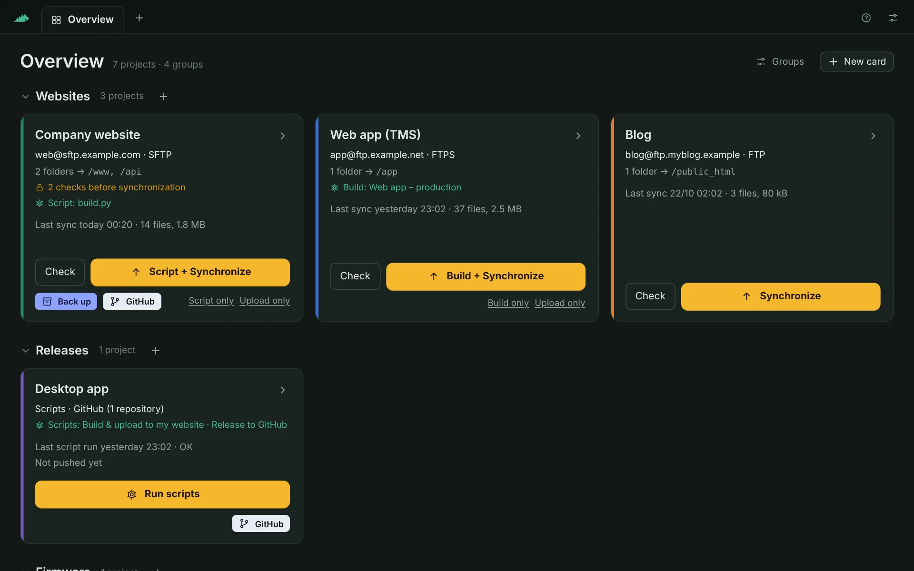
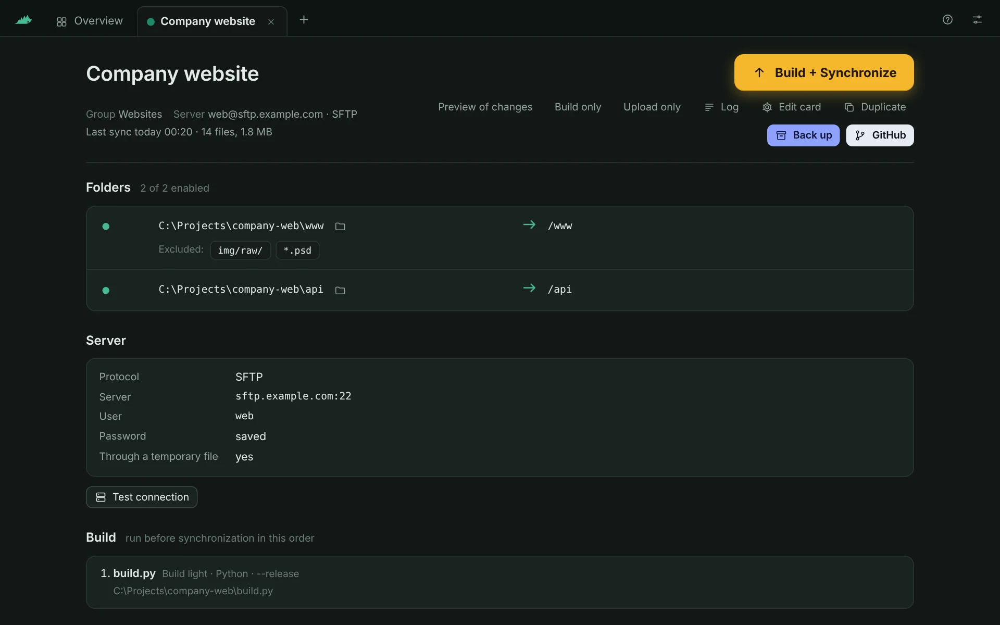
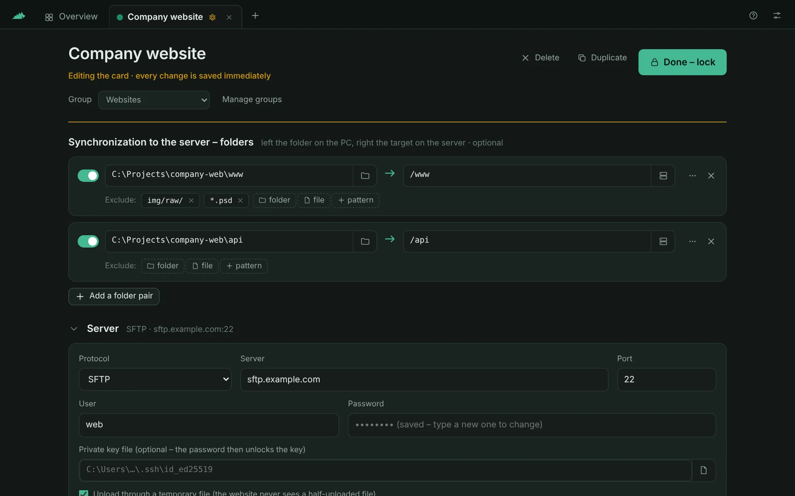
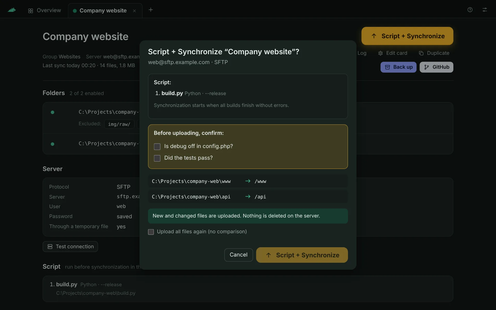
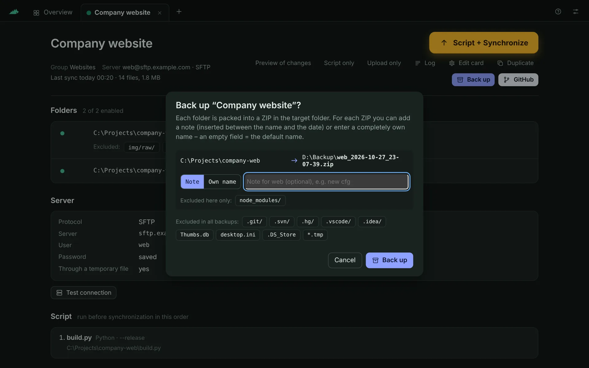
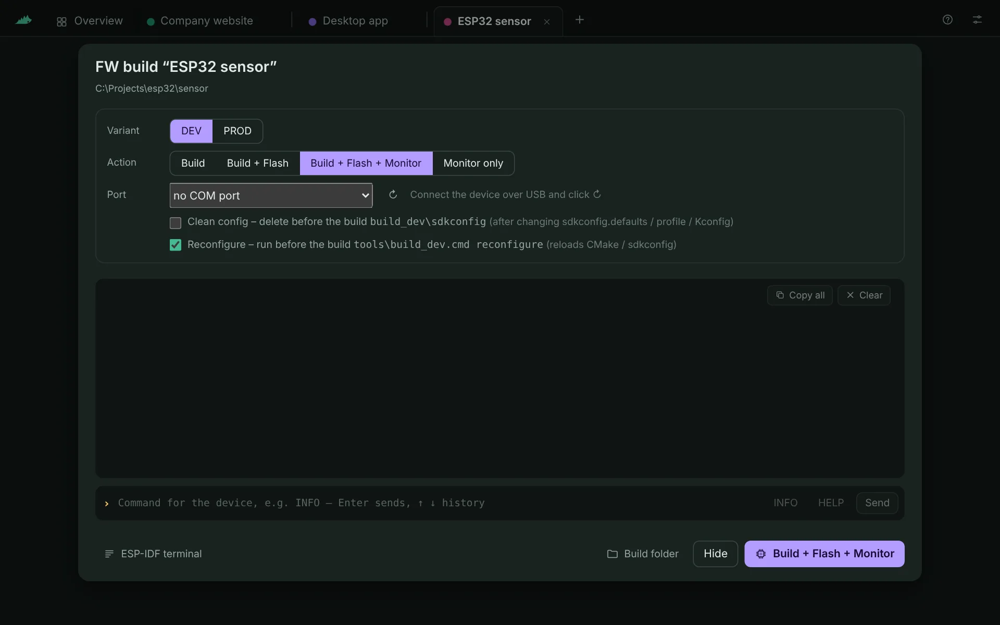
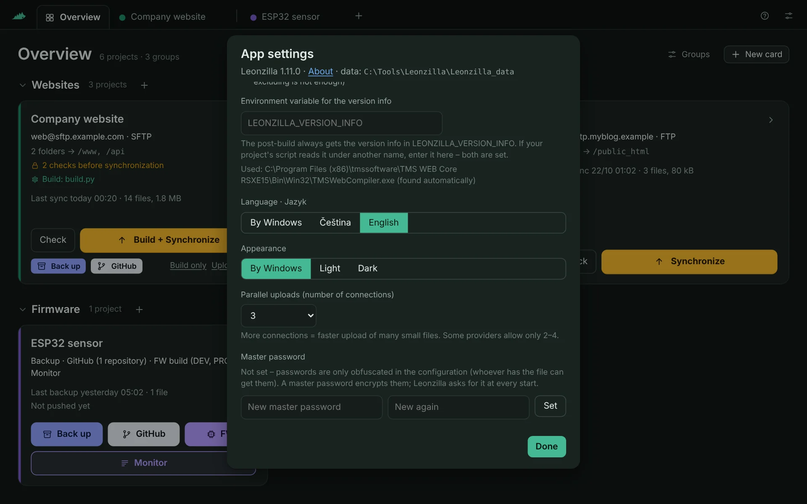
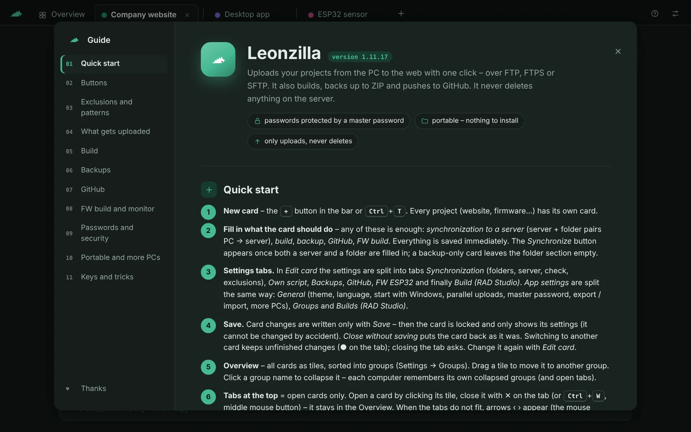
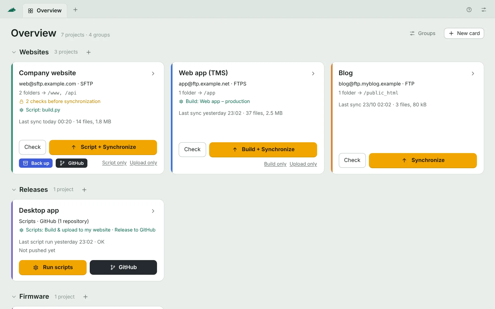
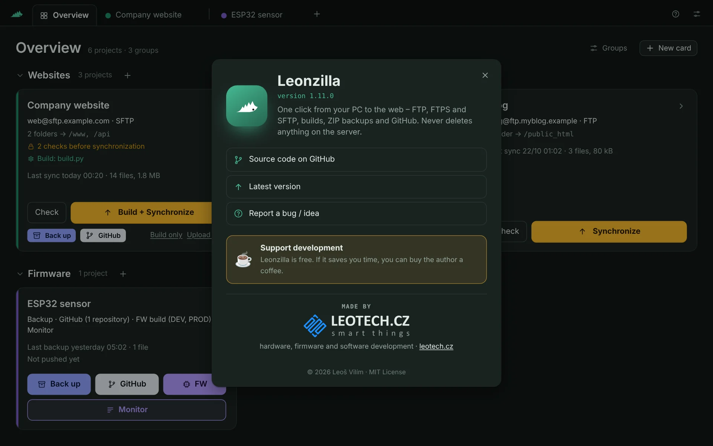

<p align="center">
  
</p>

<h1 align="center">Leonzilla</h1>

<p align="center">
  <b>One click from your PC to the web.</b><br>
  Upload folders over FTP / FTPS / SFTP, build first, back up to ZIP, push to GitHub –<br>
  a small portable Windows app that never deletes anything on your server.
</p>

<p align="center">
  <a href="https://github.com/Leontech/leonzilla/releases/latest/download/Leonzilla.zip"><b>⬇ Download Leonzilla for Windows</b></a>
  &nbsp;·&nbsp; <a href="https://github.com/Leontech/leonzilla/releases">All releases</a>
  &nbsp;·&nbsp; <a href="README.cs.md">Česky</a>
  &nbsp;·&nbsp; <a href="https://ko-fi.com/leotechcz">☕ Buy me a coffee</a>
</p>

<p align="center">
  <a href="https://github.com/Leontech/leonzilla/releases/latest"></a>
  
  <a href="LICENSE"></a>
</p>



## Safe and portable by design

- 🔒 **Master password** – server passwords are encrypted with a key derived from your master password (scrypt + AES-256-GCM). Leonzilla asks for it **every time it starts**; without it nobody can read the passwords from the configuration file – not even with Leonzilla itself.
- 🧳 **Portable** – no installer, no service, nothing written to the registry (unless you turn on start with Windows): just `Leonzilla.exe` and a `Leonzilla_data` folder next to it. Copy it to a USB stick or keep it in Dropbox and use it on several PCs (per-PC things like window size stay outside Dropbox).
- 🛡 **Never deletes on the server** – only uploads new and changed files, through a temporary file renamed when complete, with a size check.
- 🔑 **SFTP host keys pinned** – a changed server key is refused until you confirm it.
- 🏠 **Local only** – the window talks to Leonzilla on `127.0.0.1` with a random port and token. No telemetry, no cloud, nothing sent anywhere but your own servers and Git remotes.

## How it started

Leonzilla began as a tool for one annoying job: **building a TMS WEB Core web app** (RAD Studio / Delphi) and getting the result onto the server. That meant opening RAD Studio, switching the right `{$DEFINE}` switches, compiling, running the post-build step and then dragging hundreds of files around in an FTP client – every single time.

So the first version did exactly that: compile the project with the command-line compiler and the chosen switches, run its post-build event and upload only what changed. One button, no IDE, no FTP client.

Once that worked, it turned out to be handy for much more than one project. Plain websites got their own cards, then came **ZIP backups** of any folder, **GitHub commit & push**, **your own Python build scripts** instead of RAD Studio, and even **building, flashing and monitoring ESP32 firmware**. Today the TMS WEB Core build is just one of the things a card can do – you can use Leonzilla only for uploading a website, only for backups, or only as a quick GitHub button.

## What it does

Every project is a **card**. A card can do any combination of these:

| | |
|---|---|
| ⬆ **Synchronize** | Compares folders on your PC with the server and uploads **new and changed files only** – over FTP, FTPS (explicit / implicit) or SFTP. Nothing is ever deleted on the server. Uploads go through a temporary file that is renamed when complete, so the website never sees a half-uploaded file. |
| ⚙ **Build first** | **TMS WEB Core / RAD Studio** projects compiled without the IDE (switches from `Predefines.inc`, CRLF conversion, the project's post-build event), or **Build light** – any Python script. Nothing is uploaded unless every build succeeds. |
| 🗜 **Back up** | Packs folders into `prefix_YYYY-MM-DD_hh-mm-ss.zip` (optionally with a note or your own name), with exclusions. |
| ⑂ **GitHub** | Walks through the card's repositories, shows changed files with diffs, commits the ticked files and pushes (optionally pull --rebase first). Uses your installed Git – no tokens stored. |
| ▣ **FW build & monitor** | ESP-IDF (ESP32) firmware variants from `tools\build_*.cmd`: build, flash, and a serial monitor with an input line and device reset. |
| ☑ **Checklist** | Items you must tick before every upload (“Is debug off?”, “Did the tests pass?”). |

And around it:

- **Overview** of all projects as tiles, sorted into groups, with live progress – several cards can synchronize at the same time.
- **Preview** (“Check”) shows what would be uploaded without uploading anything.
- **Exclusions** per folder pair or per card: `node_modules/`, `*.psd`, `img/raw/`, `build*/` …
- **Master password** – server passwords encrypted with scrypt + AES-256-GCM (optional).
- **Portable** – one exe and a `Leonzilla_data` folder next to it. Keep both in Dropbox and use them on several PCs.
- **Czech and English** UI, light and dark theme, built-in guide (F1) and a PDF manual.

## Screenshots

| | |
|---|---|
|  |  |
| A card – folders, server, build | Editing a card – every change is saved immediately |
|  |  |
| Build + Synchronize with a checklist | Backup to ZIP with an optional note |
|  |  |
| ESP32 firmware build, flash and serial monitor | Settings – language, theme, master password |
|  |  |
| Built-in guide (F1) | Light theme |
|  | |
| About – click the logo | |

## Download and run

1. Download **[Leonzilla.zip](https://github.com/Leontech/leonzilla/releases/latest/download/Leonzilla.zip)** from the latest release.
2. Unpack it anywhere (e.g. `C:\Tools\Leonzilla` or a Dropbox folder) and run `Leonzilla.exe`. Nothing is installed.
3. Click **+** to create the first card, fill in what it should do and press **Done – lock**.

Requirements: **Windows 10 / 11 x64** with Microsoft Edge **WebView2** (always present in Windows 11; without it Leonzilla opens in your browser). Builds need TMS WEB Core / Python / ESP-IDF only if you use them; GitHub needs [Git for Windows](https://git-scm.com).

> Windows SmartScreen may warn about an unknown publisher the first time – the exe is not code-signed. Choose *More info → Run anyway*, or build it yourself from source (below).

The guide is built in (**?** button or **F1**) and also included as a PDF: [English](docs/Leonzilla_manual.pdf) · [Czech](docs/Leonzilla_navod.pdf).

## TMS WEB Core builds in short

- Create a build once in *App settings → Builds*: the `.dproj`, the configuration and the switches you want on.
- Switches are read from the top of `Predefines.inc`. Wrap that part in `{$IFNDEF LEONZILLA} … {$ENDIF}` – RAD Studio keeps using the file as it is, while a Leonzilla build skips the block and passes `LEONZILLA` plus the switches you ticked via `/Defines`.
- The project's post-build event runs as in RAD Studio. A one-line **version info** is passed to it in `LEONZILLA_VERSION_INFO` (and optionally under your own variable name) – handy for writing a `version.json`.
- The build output (`TMSWeb`) can be excluded from Dropbox, so Dropbox does not lock freshly compiled files.

## Security details

- **Master password** (*App settings → Master password*): set it once and all server passwords in `Leonzilla_data\config.json` are encrypted (scrypt key derivation + AES-256-GCM). At every start Leonzilla shows a lock screen and asks for it; the key lives only in memory while the app runs. Change or remove it any time.
- **Without a master password** passwords are only obfuscated (AES with a key inside the app) – unreadable in the file, but anyone with both the file and Leonzilla could recover them. Use the master password if the folder is shared (Dropbox, USB stick).
- A **forgotten master password cannot be recovered** – you just enter the server passwords again.
- The window talks only to Leonzilla on the same PC (`127.0.0.1`, random port and token). Nothing is sent anywhere except to your own servers and Git remotes; Git sign-in is handled by Git itself, Leonzilla stores no tokens.
- SFTP host keys are remembered on first use; a changed key is refused until you confirm it. FTPS certificates are verified (can be relaxed per card for providers with a mismatching certificate).
- **Never share or commit your `Leonzilla_data` folder** – it contains your server settings.

## Portable and more PCs

- Nothing to install: `Leonzilla.exe` + `Leonzilla_data` (cards, settings, upload state, logs) in one folder.
- Keep the folder in Dropbox / OneDrive and run it on several PCs – changes from another PC are picked up when you return to the window. Only the window size and position are stored per PC (in `%LOCALAPPDATA%\Leonzilla`).
- One instance per PC – starting it again brings the open window to the front.
- Optional **start with Windows** (minimized) – set per PC, off by default.

## Building from source

Go 1.24, no CGO. From the repository root (PowerShell):

```powershell
$env:GOOS="windows"; $env:GOARCH="amd64"; $env:CGO_ENABLED="0"
go build -trimpath -ldflags "-H windowsgui -s -w" -o Leonzilla.exe .
```

- `go vet ./...` and the headless mode also work on Linux / macOS: `LEONZILLA_HEADLESS=1 LEONZILLA_DATA=./data LEONZILLA_PORT=18765 go run .` prints a URL to open in a browser (no native dialogs there).
- `tools/sftptestserver` – a tiny local SFTP server for testing; `tools/mkres` – regenerates the icon / version resource; `tools/navod_pdf.py` – PDF manual from the built-in guide.
- Every version change in `main.go` pushed to `main` is built and released by GitHub Actions.

### Project layout

| | |
|---|---|
| `main.go`, `api*.go` | start, local HTTP API for the UI |
| `sync.go`, `remote.go` | comparison and upload, FTP / FTPS / SFTP |
| `build.go`, `buildlight.go` | RAD Studio / TMS WEB Core builds, Python scripts |
| `backup.go`, `git.go`, `fw.go` | ZIP backups, Git, ESP-IDF + serial monitor |
| `config.go` | settings, password encryption, upload state |
| `*_windows.go` | window (WebView2), dialogs, Dropbox, autostart, serial ports |
| `ui/` | the whole UI – HTML / CSS / JS embedded in the exe |
| `i18n*.go`, `ui/i18n.js`, `ui/lang_en.js`, `ui/help_en.js` | translations |

### Translations

The UI is written in Czech; English is applied at run time from `ui/lang_en.js` (Czech text → English, `{}` for values). `python tools/i18n_extract.py` lists texts that are still missing. Backend messages use `T("…")` with translations in `i18n_en.go`. Another language means one more catalog and a language button – pull requests welcome.

## Feedback and support

Bugs and ideas: [GitHub Issues](https://github.com/Leontech/leonzilla/issues). Author: **Leoš Vilím** – [leotech.cz](https://leotech.cz).

Leonzilla is free. If it saves you time, you can [buy me a coffee on Ko-fi ☕](https://ko-fi.com/leotechcz) – thank you!

## License

[MIT](LICENSE) © 2026 Leoš Vilím
